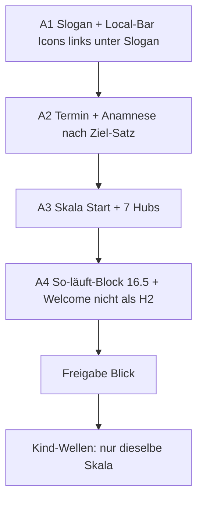

# Umsetzungsplan – Typo, Erstkontakt, Local-Bar (Start + Hubs)

Stand: 2026-08-17 · Messung Live 390/1280 · Google: Helpful Content + Page Experience (Stand 2025-12)  
Geltungsbereich Welle A: Start + 7 Hubs. Kindseiten erst danach, **dieselbe** Skala.

## Was Google wirklich sagt (kein Font-Pixel-Rezept)

E-E-A-T ist **kein Rankingfaktor mit Schriftgrößen**. Trust ist der wichtigste Teil. Für YMYL (Heilkunde) wiegt das stärker.

Aus Search Central, wörtlich relevant:

- Inhalt soll **nicht schlampig oder hastig** wirken („spelling or stylistic issues“, „produced well“).
- Page Experience: Seite **zeigt sich gut auf Mobilgeräten**; Besucher können den **Hauptinhalt leicht vom Rest unterscheiden**.
- Mobile-first: Google indexiert die **mobile** Fassung.
- Kein einzelnes Page-Experience-Signal; CWV zählen, der Rest belohnt vor allem, weil Menschen bleiben.

Daraus für uns: **eine stabile Skala**, kontrastreiche klare Hierarchie, keine dauernden Einzel-Patches, Mobil vor Desktop. Nicht: neue Mode-Schrift, nicht jede Welle neue px-Werte.

## Ist-Messung (warum es unruhig wirkt)

| Element | Start mobil | Hub mobil | Problem |
|---------|------------:|----------:|---------|
| H1 | Ubuntu 30 / 500 | Ubuntu 30 / 500 | ok |
| Slogan | Open Sans 18 | **Ubuntu 45** | Hub-Slogan größer als H1 |
| Slider-H2 | – | Open Sans **31** | größer als H1 30 |
| Welcome-Block | H2 24, ganzer Absatz | – | Überschrift missbraucht |
| Body | Open Sans 18 / oft 300 | 18 | dünn, „So läuft…“ zu wuchtig |
| 11-px-Reste | 2 | 2–4 | unprofessionell |
| Termin + Anamnese | ~3124 px tief | Hub oft ohne Paar | zu spät |
| Local-Bar | direkt unter H1, zentriert | gleich | Slogan verdeckt / Reihenfolge falsch |

Schriften live: **Ubuntu** (Titel) + **Open Sans** (Text). Farben: `#2a2622` auf Beige/Petrol – Kontrast nach #11 in Ordnung.

## Entscheidung Schriften/Farben

**Behalten.** Keine dritte Datei, kein Google-Fonts-Nachladen.  
Ändern: Gewichte und Stufen, nicht die Familie.

- Titel: Ubuntu 500  
- Fließtext: Open Sans **400** (nicht 300)  
- Farbe Text `#2a2622`, Links wie bisher, CTA-Beige `#bebaa0` / Rahmen `#8ec760`  
- Keine Gold-auf-Petrol-Kleintexte mehr

## Eine Skala (Mobil zuerst, Desktop nur größer)

| Rolle | Mobil | Desktop | Semantik |
|-------|------:|--------:|----------|
| H1 | 28–30 | 36 | genau eine |
| Slogan | 17–18 | 18–19 | `p`, kein H2 |
| H2 Abschnitt | 22 | 26 | kürzer als H1 |
| H3 Karten | 18 | 20 | nicht 11, nicht 24-als-Absatz |
| Fließtext | 16.5 | 17–18 | „So läuft…“ inklusive |
| NAP / Zeiten | 15–16 | 16 | Local-Bar |
| Buttons | 16 | 16 | min. 44 px hoch |

Diese Tokens **einmal** in HFCM (Typo-Datei). Danach keine Einzel-px-Wellen mehr.

## Status 17.08. (A1–A4 live)

Slogan sichtbar · Bar mit SVG-Icons links unter dem Slogan (H1-Kante) · eine Skala nur `html.eeat-type-a` (Start+7 Hubs) · Welcome-Absatz kein H2 · „So läuft…“ 16,5 px · CTA-Paar nach Ziel-Satz (Start). Kindseiten unverändert.

## Wellen

### A1 – Slogan und Local-Bar (HFCM #15 + #17)

- Slogan **wieder sichtbar**: „Naturheilkundlich begleiten – Stark im Leben“ (Hide-Regel in #15 streichen).
- Slogan bleibt unter dem H1, links wie der Titel.
- Local-Bar **darunter**, links bündig (`justify-content: flex-start`, gleiche Padding-Kante wie H1).
- Text-Buttons → kompakte Icon+Label-Chips, inline SVG (Telefon, Pin, Uhr), `aria-hidden` aufs Icon, sichtbarer Text bleibt („Anrufen“, „Route“, Zeiten).
- Kein Icon-Font, keine Extra-Request.

### A2 – CTA-Paar (HFCM #8 + Platz-Skript)

- „Jetzt Termin buchen“ + „Online-Anamnesebogen“ **nach** dem Satz „Ziel der Arbeit ist mehr körperliches und seelisches Wohlbefinden im Alltag.“
- Nur Start (Hubs haben diesen Block nicht).
- Einander gleiche Breite, 44 px, untereinander mobil, links oder max. 450 px wie bisher – nicht mit der Local-Bar vermischen.

### A3 – Skala Start + Hubs (eine CSS-Datei, z. B. Erweiterung #11)

- Tokens oben durchsetzen, `!important` nur wo YOO überschreibt.
- Hub: Slogan 45 px → 17–18 px; Slider-H2 31 → Overlay-Größe getrennt von Inhalts-H2 22.
- H1 bleibt die größte **Inhalts**-Stufe.
- Open Sans 300 → 400 im Fließtext.

### A4 – Wucht und Semantik Start

- Block „So läuft ein Termin … Themen zum Weiterlesen“ auf Fließtext 16.5 / Zeile 1.5, nicht 24-als-H2.
- Welcome-Absatz von H2 auf Absatz (sonst bleibt er „wuchtig“).
- Leere H-Tags weiter aus.
- Mobil prüfen: erster Screen = Slider + H1 + Slogan + Local-Bar. CTA erst nach Ziel-Satz (scroll, aber früh).

### Danach Kindseiten

Gleiche Tokens, 10er-Wellen, **keine** neuen Größen. Nur anwenden, wo Kindseiten aus der Skala fallen.

## Nicht in dieser Serie

Neue Website-Schrift, Farb-Rebrand, Karten-iframe, Desktop-first, Innenstadt, zweites Disclaimer, Kindtexte umschreiben.

## Erfolg

Mobil 390 und Desktop 1280, Start + jeder Hub:

1. Slogan sichtbar, Bar darunter, links, mit Icons.  
2. Termin+Anamnese nach Ziel-Satz (Start).  
3. H1 > H2 > Text, keine 45-px-Slogans, keine 11-px-H3.  
4. „So läuft…“ optisch leichter als H1.  
5. Kontrast unverändert AA. Kein LCP-Rückfall.
