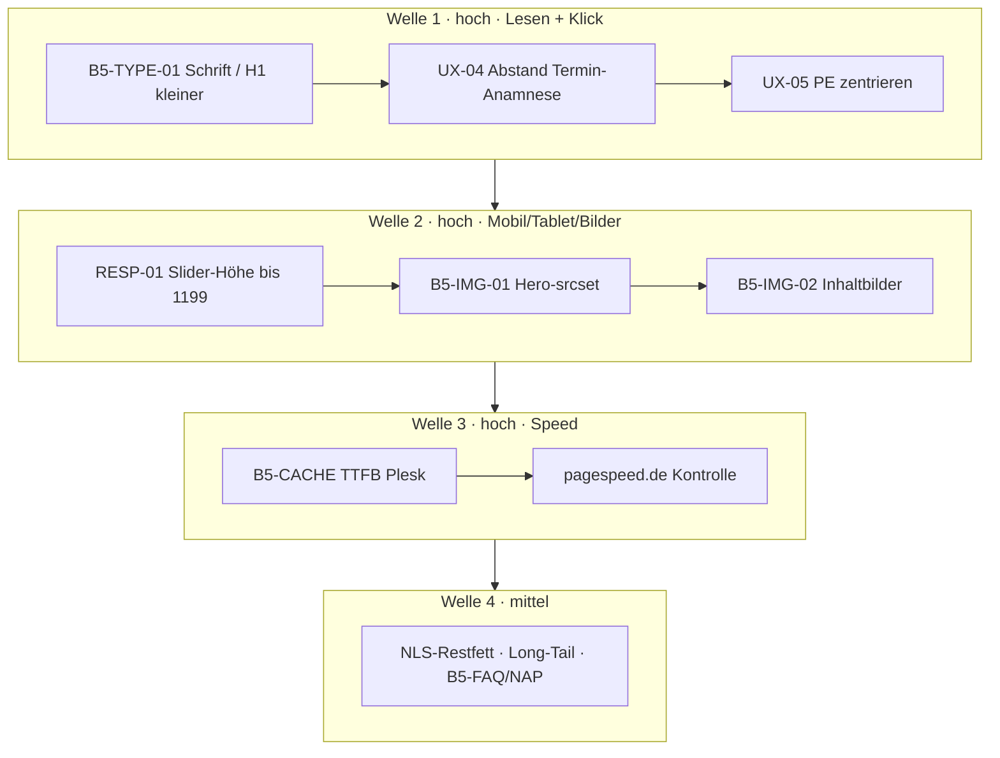

# Umsetzungsplan – rauch-heilpraktiker.de (konsolidiert)

Stand: 2026-08-15 · Welle 1–3 gemessen (Plesk TTFB ok, nginx HTML weiter MISS)  
Massgabe: Repo `redshift-three67/naturheilpraxis-eeat` · Live CDP `127.0.0.1:9224` · ein Schritt nach `docs/WORKFLOW.md`

**B5** = Ableitung von der öffentlichen Struktur/Technik von buerofuenf.de (keine Inhalte, kein Design-Klon).  
Nur das, was hier messbar hilft: Lesbarkeit, Hub-Struktur, Cache, Bildgröße, eine H1, sichtbares Schema.

---

## Pagespeed (Referenz, nicht neu gemessen)

Quelle: pagespeed.de 15.08.2026, Startseite.

| | Mobil 13:05 | Mobil 13:48 | Desktop 13:49 | Ziel |
|---|---:|---:|---:|---|
| Note | 79 | **82** | **97** | Mobil ≥ 90 |
| LCP | 4,91 s | **4,53 s** | 1,18 s | < 2,5 s |
| FCP | 2,17 s | 1,88 s | 430 ms | < 1,8 s |
| CLS | 0,035 | 0,025 | 0,003 | < 0,1 |
| TBT | 4 ms | 29 ms | 0 ms | ok |
| TTFB | ~0,9 s | **961 ms** | 854 ms | < 400 ms |

Live zusätzlich: Brotli **an** (Tool-Kachel war falsch), HTTP/2, HSTS.  
Zwei Bremsen: **TTFB ~0,9 s** (Hosting) und **LCP-Hero** (zu großes First-Image + Slider-Höhe auf Tablet/Laptop).

---

## Live-Befund UX / Bilder (CDP 15.08., Startseite)

| Viewport | Abstand Termin→Anamnese | Kontakt PE+Button | Hero angezeigt | Hero-Datei |
|----------|------------------------:|-------------------|----------------|------------|
| 390 Mobil | **10 px** (zu eng) | PE oft **0×0** (lazy), Button 409 px | 439×292 | **1583 px** breit |
| 768 Tablet | 10 px | PE+Button **rechts** (Mitte +273 px) | **972×646** | **1920 px** |
| 1024 Laptop | 10 px | Button bei x=870, nicht zentriert | **1344×894** | 1500–1920 px |
| 1280 Desk | 10 px | Button bei x=1049, PE 0×0 | 1475×981 | 1688 px |

SPEED-01 greift nur `max-width: 959px` und verliert auf Tablet gegen YOO (`height: 646` statt max 400).  
`fitPeWidth()` setzt die Anamnese-Breite an ein noch nicht geladenes PE-Bild → Breite 0 / Versatz.

Schrift jetzt: H1 **46 px / 300**, Mobil ~35 px / 300; Fließtext **18/27 / 300**; Disclaimer 16,2 / 300.

---

## B5 – was wir übernehmen (und was nicht)

| ID | Übernehmen | Warum hier |
|----|------------|------------|
| **B5-TYPE** | Typo-Skala für ältere Leser: Gewicht 400, H1 kleiner, Zeile ≥ 1,55 | E-E-A-T + WCAG, Praxis-Publikum |
| **B5-H1** | Eine klare H1, etwas kleiner als jetzt | Hierarchie, nicht „Plakat“ |
| **B5-CLUSTER** | Hub → Kindseiten, keine Textwände | schon VERF/HUB; Long-Tail nur bei Bedarf |
| **B5-CACHE** | HTML-Cache / kurzes TTFB (bei uns: Plesk nginx/OPcache) | wie deren Varnish-HIT |
| **B5-IMG** | Richtige Dateibreite + modernes Format | WebP da, **srcset/Größe fehlt** |
| **B5-NAP** | Adresse/Tel/Geo nur wie sichtbar, MedicalClinic | kein LocalBusiness zurück |
| **B5-FAQ** | FAQ nur wenn die Antwort sichtbar im HTML steht | später, keine Keyword-Farm |
| **Nicht B5** | Product-Schema, 100 Glossar-URLs, GTM-First, Award-Leiste | YMYL / irreführend |

---

## Nächste Arbeit – Reihenfolge zur Freigabe

Ein Live-Schritt nach dem anderen. Hoch/mittel aus der alten Tabelle stecken in Welle 1–3.

### Welle 1 – Lesbarkeit und Klickfläche (hoch)

| ID | Schritt | Inhalt | Prio |
|----|---------|--------|------|
| **B5-TYPE-01** | ~~H1 36/30, Gewicht 400/500~~ live | hoch |
| **UX-04** | ~~Abstand 21 px, Button 450, Padding 14/20~~ live | hoch |
| **UX-05** | ~~PE+Button gleiche Breite nach Bild-Load~~ live · Tablet/Desk = rechte Kontaktspalte | hoch |

### Welle 2 – Responsiveness und Bilder (hoch)

| ID | Schritt | Inhalt | Prio |
|----|---------|--------|------|
| **RESP-01** | ~~Slider 320/380 bis 1399 px~~ live | hoch |
| **B5-IMG-01** | ~~sizes 100vw, Folie 1 eager, 2–n lazy~~ live · Mobil 488 w statt 1583 | hoch |
| **B5-IMG-02** | ~~Inhaltbilder sizes+lazy~~ live (teilweise; Markup-width bleibt YOO) | mittel-hoch |

**Bilder besser einbinden (Technik, kein Plugin-Wettlauf):**

1. **Richtige Breite:** Mobil ~800 w, Tablet ~1200 w, Desk ~1600 w – nicht 1920 an 390 px.  
2. **Nur LCP eager.** Alle anderen Slider- und Below-fold-Bilder `loading="lazy"` `decoding="async"`.  
3. **Ein Format-Pfad:** YOO-WebP behalten; AVIF nur wenn YOO es ohne Doppel-Download kann.  
4. **Dimensionen im HTML** (`width`/`height` oder aspect-ratio), sonst CLS.  
5. **Kein Kenburns** (schon aus auf <960; auf Tablet mitziehen).  
6. **TTFB getrennt:** kleines Bild hilft nicht, wenn HTML 0,9 s braucht (**B5-CACHE** = Plesk).

### Welle 3 – Speed Hosting (hoch, nicht dieses Repo allein)

| ID | Schritt | Inhalt | Prio |
|----|---------|--------|------|
| **B5-CACHE / TTFB** | ~~curl TTFB 0,25–0,28 s~~ (Ziel &lt; 0,4 s). `x-cache-status` bleibt **MISS**, `max-age=0`. Gewinn = PHP 8.2 / OPcache, nicht HTML-Proxy-HIT. | hoch |
| **QW-SPEED-PLUGINS** | Async JS + Speed Booster **nur Test**, Default bleibt aus | mittel |
| **SPEED-03** | ~~pagespeed.de 20:11~~ Mobil 81 / TTFB 255 ms / LCP 4,82 s · Desktop 98 / TTFB 244 ms | hoch |

### Welle 4 – Rest EEAT/Content (mittel)

| ID | Schritt | Prio |
|----|---------|------|
| NLS-Intro-Restfett | mittel |
| Long-Tail Microkinesie / Dorn / weitere IMT-Lowen-Seiten | mittel, nur bei Bedarf |
| **B5-FAQ-01** | echte Patientenfragen als sichtbarer Block, kein Glossar-100 | niedrig-mittel |
| **B5-NAP-01** | sichtbare NAP gegen Schema-Snippet | mittel |

### Welle 5 – Klein / extern (niedrig bzw. später)

| ID | Schritt | Prio |
|----|---------|------|
| QW-NOINDEX-PLUGIN deinstallieren | niedrig |
| QW-TITELCASE Rank Math | niedrig |
| Kontakt-Satz + Anamnese-Link | niedrig |
| GBP / lokale Verzeichnisse | mittel **nach** Welle 3 |

---

## Vorgeschlagene erste drei Live-Schritte (wenn Plan ok)

1. **B5-TYPE-01** – Schrift (H1 runter, Gewicht rauf)  
2. **UX-04** – Abstand/Breite Termin + Anamnese  
3. **UX-05** – PE + Anamnese zentrieren (load-sicher)

Dann RESP-01 + B5-IMG-01, danach Plesk-TTFB und neue pagespeed.de-Messung.

Keine Parallel-Writes. Prewrite → ein Schritt → Verify Desktop **und** 390 / 768 / 1024.

---

## Erledigt (nicht zurückdrehen)

TQW-01…04 · SCHEMA-01…04 · META-01…06 · NOINDEX-01 · APP-01…07 · SPEED-01/02 · SLIDER-01 · UX-01/02 · QW-SITEMAP · HWG-01 · CONTENT-01/01b · KONTRAST-01 · HUB-01…07 · Hospital-Reste · VERF-01…15.

