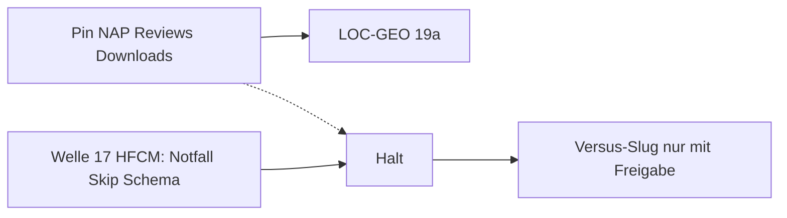

# Umsetzungsplan – rauch-heilpraktiker.de (konsolidiert)

Stand: 2026-08-17  
Quellen: Live-Wellen 1–16 + WV · B5- und Polinacea-Masterpläne (`archive/2026-08-17/ANALYSEN-B5-POLINACEA.md`)  
CDP `127.0.0.1:9224` · Repo `naturheilpraxis-eeat` · `docs/WORKFLOW.md`

YMYL/HWG: keine Heilversprechen · Disclaimer nur HFCM #7 · Schema nur HFCM #6 + Rank Math  
**B5** = Struktur/Technik, kein Inhaltsklon. **Polinacea** = gleiche Branche, Innenstadt – Lage nicht imitieren.

---

## Auftrag (gültig)

1. Lokal glaubwürdig für **Augsburg-Ost / Hochzoll / Friedberg**, nicht „zentral Augsburg“.  
2. Eine Sprache auf Hubs und Kindseiten (Wellen 13–16 live).  
3. Keine neuen Thin-URLs, kein Glossar, kein Product/Service-Schema, kein zweites Disclaimer.

**Inhaltlich erledigt:** Wellen 1–16, Cluster #13, Legal #14, Slogans #15.

---

## Filter aus den beiden Analysen

Übernommen nur bei **Nutzen + Beleg + stabiler Umsetzung** (HFCM oder ein bestehendes Feld).

| Übernehmen | Nicht übernehmen |
|------------|------------------|
| Schema nur sichtbare Daten (`priceRange` / `medicalSpecialty` prüfen) | Neue Pillar `/heilpraktiker-augsburg/` (Start ist die Pillar) |
| Eine FAQ „Notfall 112 / Arzt“, im **bestehenden** #7 | Eigene `/notfallhinweis/` oder zweiter Body-Disclaimer |
| Skip-Link (WCAG, live fehlend) | 48 Kindseiten mit Risiko-/Kosten-Blöcken |
| Kosten-FAQ ohne Preise, nach Deiner Bestätigung | Ratgeber-Farm, Leitlinien-Listen ohne Primärquelle |
| Apple/Bing/NAP/Reviews bei Dir | Service-Schema, ProfessionalService statt Clinic |
| GBP/Pin/Geo 19a (schon WV) | Rank Math Pro / Yoast / zweites SEO |
| Ads nur Start + 7 Hubs | Case Studies, Awards, Orts-Klone, Review-Markup |
| llms.txt optional **später** | BreadcrumbList ohne sichtbare Breadcrumbs |

---

## Wiedervorlage (alles noch Offen, im Auge behalten)

### Nach der Pause – klein, bei uns, Freigabe nötig

| ID | Inhalt | Bedingung |
|----|--------|-----------|
| **W17-FAQ-NOTFALL** | FAQ „Was tun im Notfall?“ in HFCM #7 | **live** 17.08. |
| **W17-SKIP** | Skip-Link HFCM #16 | **live** 17.08. |
| **W17-SCHEMA-HYG** | `priceRange` / `medicalSpecialty` entfernt | **live** 17.08. |
| **W17-FAQ-KOSTEN** | FAQ „Wie sind die Kosten?“ Privatleistung, keine Preise | **live** 17.08. |
| **WV-VERSUS-SLUG** | `/bioresonanz-und-elektroakupunktur/` + 301 von versus | **live** 17.08. |
| **WV-RM** | Seiten-Schema-Standard **Keiner**; „loszuwerden“ im DOM per HFCM #15 entfernt (Quelltext-Article bleibt) | **live** 17.08. |

### Bei Dir (Local Pack, höherer Hebel als W17)

| ID | Inhalt |
|----|--------|
| **GBP-PIN** | Maps-Pin **19a** + Breite/Länge an uns |
| **GBP-NAP** | GBP = Impressum; Kategorie Heilpraktiker; keine Heilversprechen im Profilnamen |
| **NAP-SEE** | Seefelder Str. 20 überall weg |
| **HOURS** | Footer-Zeiten bestätigen oder korrigieren (Mo–Fr 10–12:30 und 13–19) |
| **AREA** | areaServed Augsburg / Hochzoll / Friedberg belassen oder streichen |
| **REVIEWS** | Neutral um Google-Bewertung bitten, keine Textvorlage |
| **CITATIONS** | Apple Business Connect, Bing Places, seriöse Profile = dieselbe NAP |
| **DL** | Fünf tote `/download/…` hochladen oder Buttons entfernen |
| **CORONA** | Menüpunkt lassen oder raus (`noindex` ist) |

### Blockiert / später

| ID | Inhalt |
|----|--------|
| **LOC-GEO** | Schema-Koordinaten der 19a | **live** 48.339465, 10.948931 (17.08.) |
| **SPEED-LCP** | Slider 240 px + LCP-Preload + erstes Folien-`src` (HFCM #9) | **live** 17.08. |
| **CACHE** | WP Super Cache, Simple, Exclude Kontakt/wp-json/GET/Login | **live** 17.08. |
| **LLMS** | `/llms.txt` optional, nur NAP + Hubs, keine Claims | Wiedervorlage |
| **SEM** | Ads-Pilot nach Pin/NAP; Landings = Start + 7 Hubs | Wiedervorlage |
| **QUALI** | Fortbildungen/Werdegang nur mit von Dir gelieferten Nachweisen | Wiedervorlage |

---

## Empfehlung für den nächsten Live-Schritt

**Nicht** noch eine Kindseiten-Textwelle.  
**Zuerst Du:** Pin + NAP (das schlägt jede FAQ).  
**Welle 17–18 live. LCP-Preload + Super Cache live.** Offen bei Dir: GBP-Zugang/Pin, Kataloge, Downloads, Corona, Reviews, Plesk-Cache-Control für Statik. Wiedervorlage: Fortbildungen, llms.txt, Ads.

Reihenfolge nach Nutzen:

---

## Lage gegen „Heilpraktiker Augsburg“ (SERP 17.08., Google.de, pws=0)

**Local Pack (3er-Karte):** 1 Palat 4,9/19 · 2 soomia/Schedler 5,0/41 · **3 Naturheilpraxis Rauch 4,9/54**, 19a. Darunter ChiMed, Arendt, Prüfer.  
Rauch zeigt im Pack **keine** Öffnungszeiten; Palat/soomia schon („Geöffnet“). Filterchip „Jetzt geöffnet“ würde uns verlieren.  
**Maps** (Stadtmitte 48,37/10,89): Palat · Polina 5,0/103 · **Rauch** · Gaigl · soomia · Schybaj am Dom.

**Organisch Seite 1 (Rauch nicht dabei):** Polinacea · Doctolib · Natural Medical Coach · Gaigl · Prüfer · Arendt · Paracelsus-Schule · Nejedli · Hessingpark.  
Related: Innenstadt, Lechhausen, Darm, Kinder, Psychotherapie, Ausbildung. Chips: Innenstadt / Jetzt geöffnet / Lechhausen.

Wir sitzen **86163 Hochzoll**. Innenstadt nicht imitieren. Natürlicher Umkreis: Hochzoll, Friedberg, Lechhausen-Ost.

Hebel jetzt: GBP-Stunden + Pin (Pack halten/heben) · Reviews · NAP. Organisch: Start bleibt die Pillar; Hubs nur `[Verfahren] Augsburg`, nicht zweites „Heilpraktiker Augsburg“.

**17.08. live (ohne GBP):** Hub-Titles/H1 mit Augsburg (NLS, Bioresonanz, Naturheilkunde, Manuell, BIT). Start-Lage-Satz + FAQ „Wo liegt die Praxis?“ (Hochzoll / 19a / Friedberg / Lechhausen-Ost).  
**Mobil 1–5 live:** Aktionszeile Anrufen/Route/Zeiten unter H1 (Start+Hubs), #7 Maps+Tel 44 px, NLS ohne Hospital/Hunter im Erstbild, leere/11-px-Überschriften, Cookie/Slider-Tap 44 px.

**Typo A1–A4 live** (Start+Hubs). Kind-Wellen derselben Skala danach. Nicht in der Serie (nach Durchsicht): neue Schriftfamilie, Rebrand.

---

## Erledigt (nicht zurückdrehen)

Wellen 1–16 · HUB-01…07 · VERF-01…18 · Cluster #13 · Legal #14 · Slogans #15 · Schema/Disclaimer/Typo/Speed-Grundlagen · Hours/areaServed im Schema (Geo offen).

Historie der Wellen: `archive/2026-08-15/` und `archive/2026-08-16/` (WELLE-12…16, WV-NACH-WELLEN).

---

## Offen bei Dir (Checkliste)

1. GBP: Friedrich-Deffner-Straße 19a, 86163 Augsburg-Hochzoll, 0821 2621462, `https://rauch-heilpraktiker.de`.  
2. ~~Pin-Koordinaten~~ live im Schema (48.339465 / 10.948931). GBP-Pin selbst setzen, sobald der Zugang da ist.  
3. Öffnungszeiten bestätigen.  
4. areaServed bestätigen oder streichen.  
5. Seefelder Str. 20 weg.  
6. Downloads oder Buttons.  
7. Corona-Menü.  
8. Google-Rezension bitten.  
9. Apple Business Connect / Bing Places gleiche NAP.  
10. Optional: Kosten-Satz und Notfall-Wortlaut gegenzeichnen, Fortbildungsnachweise.

---

## Wellen 12–16 (Archiv, abgeschlossen)

**12** Hubs lokal ohne Geo · **13** NH-Kinder · **14** Hinweisdiagnostik · **15** BIT/Bio/Schmerz/Qigong · **16** Manuell/Lowen.
