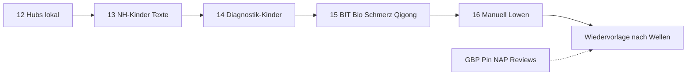

# Umsetzungsplan – rauch-heilpraktiker.de (konsolidiert)

Stand: 2026-08-16 · Freigabe: **Hubs lokal** + **Kindseiten-EEAT an Hubs** (Texte, H1, Metas)  
CDP `127.0.0.1:9224` · Repo `naturheilpraxis-eeat` · `docs/WORKFLOW.md`  
YMYL/HWG: keine Heilversprechen · Disclaimer nur HFCM #7 · Schema nur HFCM #6 + Rank Math

**B5** = Struktur/Technik (kein Klon von buerofuenf.de oder der Konkurrenz).

---

## Auftrag (jetzt gültig)

1. Hubs lokal googletauglich für **Augsburg und Umkreis** (Ost/Hochzoll/Friedberg).  
2. Die 48 Kindseiten in **allem, was bisher nicht gleich war**, an die Hubs ziehen: kurze Absätze wie VERF, eine sachliche H1, Metas 120–160, kein Claim. Technik ist schon sitewide gleich.  
3. Hebel an der **sichtbaren Top-Gruppe** ausrichten, nicht an neuen URLs.

**Welle 12–15 live.** Geo sobald Pin da.  
Nächster Live-Block: **Welle 16** (Manuell + Lowen).

---

## Top-Gruppe „Heilpraktiker Augsburg“ (Deine Links, live geprüft 16.08.)

Hinweis: `polinacea-heilpraktikerin.de` löst nicht auf. Live ist **`polinacea-heilpraktiker.de`**.  
`naturheilunde-am-hessingpark.de` = **`naturheilkunde-am-hessingpark.de`**.

| Praxis | Lage | Was die Seite lokal tut | Für uns relevant |
|--------|------|-------------------------|------------------|
| Polinacea / Schrott | Stettenstr. 28, **86150 Innenstadt** | Title „Heilpraktikerin in Augsburg“, **keine H1**, nur WebSite-Schema | Innenstadt-Query; wir nicht „zentral“ imitieren |
| Ruhl | Neuburger Str. 229, **86169 Hammerschmiede** | Ästhetik+NH, Sprechzeiten + Karte sichtbar, kein Medical-Schema | Stadtteil + Zeiten sichtbar = Local-Hebel |
| Ruf / Schwerd-Ruf | 86150 | **H1: Praxis-Schließung 12.06.25**, verweist auf Prüfer/Lechhausen | Kein aktiver Gegner; Rest-Ranking möglich |
| Hessingpark | **86199** (Göggingen / Hessing) | Standort im Title/H1, Osteopathie+NH | Stadtteil-Marke; unser Gegenstück = **Hochzoll** |
| Prüfer | **86167 Lechhausen** | H1 „Ihre Heilpraktikerin in Augsburg“, Familie, Meta mit Infekt/Allergie/Schmerz | Stadt + Familie; **keine** Symptom-Metas kopieren (HWG) |
| Julia Schmid | Maximilianstr. 47, **86150**, Ästhetik | H1 mit Augsburg, Beauty-Fokus | Anderes Angebot; Innenstadt |
| Gaigl `naturheilpraxis-augsburg.de` | Jakoberstr. 5, **86152 Innenstadt** | **Exact-Match-Domain** + H1 „Heilpraktiker in Augsburg“, „zentral“ | Stärkster reiner KW-Title; Domain nicht nachbauen |

Gemeinsam: **Stadt im Title und meist in der H1**, Lage (Innenstadt, Stadtteil oder Landmarke), schlanke Startseite, Breadcrumbs. Fast niemand hat `MedicalClinic`+`Physician`. Mehrere sitzen **innenstadt-west/nord**; wir sitzen **86163 Hochzoll (Ost)**.

Umkreis, der zu uns gehört (nicht die Innenstadt gewinnen): **Hochzoll, Friedberg, Lechhausen-Ost, Hochzoll-Süd, Grenzbereich Hammerschmiede nur als areaServed, nicht als Fake-Standort**.

---

## Hebel, priorisiert Augsburg lokal + Umkreis

| Prio | Hebel | Warum gegen diese Top-Gruppe | Wer |
|------|-------|------------------------------|-----|
| 1 | **GBP + Maps-Pin auf 19a Hochzoll** | Local Pack ist Entfernung. Falscher Pin = Innenstadt-Konkurrenz auf deren Terrain | **Du** |
| 2 | **Schema-Geo = Praxis, nicht Stadtmitte** | Ist-Wert `48.3665, 10.8944` = Augsburg-Zentroid (latlong.net), **nicht** Hochzoll (~48.35 / ~10.95) | Wir nach Deinem Pin |
| 3 | **openingHours + areaServed** im Schema | Ruhl zeigt Zeiten; wir haben sie nur im Footer. Area: Augsburg, Hochzoll, Friedberg | Wir (Welle 12) |
| 4 | **Hub-H1/Title mit Augsburg, Lage Hochzoll wo natürlich** | So arbeiten Gaigl/Prüfer/Polinacea. Nicht jede Lowen-URL | Wir |
| 5 | **Google-Bewertungen** | Maps schlägt Jameda/ProvenExpert für lokal | **Du** |
| 6 | **Kindseiten = Hub-EEAT** (kurze Absätze, 1 H1, Meta) | Top-Sites sind dünn, aber widerspruchsfrei. Lange Claim-Kinder unterlaufen den Hub | Wir ab Welle 13 |
| 7 | NAP-Altlast Seefelder Str. 20 | Widerspricht GBP | **Du** |
| 8 | Mobil-LCP | Die meisten Konkurrenten sind leichter; LCP bei uns noch CSS/JS | später, mit Exclude |

Nicht: Domainwechsel, „zentral Augsburg“, Symptom-Metas wie Prüfer, Product-Schema, Glossar, Award-Leiste.

SEM: Ads erst nach Welle 13-Kern (Naturheilkunde + Diagnostik-Kinder sauber). Landings = Start + 7 Hubs, nicht 7 Lowen-URLs.

---

## Kindseiten: was schon gleich ist / was jetzt angeglichen wird

**Schon gleich (sitewide, nicht nochmal bauen):** Schema, Disclaimer/NAP/FAQ, Anamnese, Footer/Cookie, Typo/Kontrast, Slider-Höhe/Bilder, Responsiveness, Cluster HFCM #13.

**Jetzt umsetzen (Freigabe „was nicht gleich ist“):**

| Stück | Hub-Massstab | Kind heute | Welle |
|-------|--------------|------------|-------|
| Fließtext | 2–4 kurze Absätze, kein „heilt“, kein zweiter Disclaimer, wenig Fett | oft alt, lang, Claims | 13–16 |
| Eine H1 | Verfahren, kein Outcome, nicht gesplittet | Restlisten aus 6–10 | mit Textwelle |
| Title/Meta | `Verfahren \| Naturheilpraxis Rauch`, Meta 120–160, Umlaute, Ort nur wenn natürlich | Dorn 12, Urin 27, ASCII, `DIE HÄNDE` | mit Textwelle |
| Diagnostik-Wort | Hinweisdiagnostik / Untersuchung, nicht „Diagnose sichert“ | H1 „Diagnose – Urin/Labor“ | mit Textwelle |

Qualität = VERF auf den Hubs (Hahnemann, Phyto, IMT). Near-Duplicates bleiben: eine lange NAET-URL, die zweite Ergänzung; EAV ≠ Voll-Verfahren; Lowen je ein Aspekt.

---

## Offen bei Dir

1. **GBP:** Friedrich-Deffner-Straße 19a, 86163 Augsburg-Hochzoll, 0821 2621462, `https://rauch-heilpraktiker.de`, Kategorie Heilpraktiker. Keine Heilversprechen.  
2. **Maps-Pin** auf der 19a? Bitte **Breite/Länge** schicken.  
3. **Öffnungszeiten** bestätigen (Footer: Mo–Fr 10–19, Mittag 12:30–13) oder korrigieren.  
4. **areaServed** bestätigen oder streichen: Augsburg, Hochzoll, Friedberg (Vorschlag).  
5. Verzeichnisse: NAP = Impressum; **Seefelder Str. 20** weg.  
6. Fünf tote `/download/…`-Dateien hochladen oder Buttons entfernen.  
7. Corona-Menüpunkt: lassen oder raus (`noindex` ist schon).  
8. Patienten um **Google-Rezension** bitten.

---

## Wellen ab jetzt

### Welle 12 – Hubs lokal

**Live:** `archive/2026-08-16/WELLE-12.md`. Geo bewusst offen.

Ohne Deinen Pin erledigt:

| ID | Inhalt |
|----|--------|
| **LOC-HOURS** | `openingHoursSpecification` aus bestätigten Zeiten (Default = Footer) |
| **LOC-AREA** | `areaServed` Augsburg, Hochzoll, Friedberg – sobald Du nicht widersprichst |
| **HUB-H1-SZ** | eine H1 `/schmerztherapie-augsburg/` |
| **NLS-HOSP** | „Hospital“ auf NLS entfernen |
| **RM-ARTICLE** | sichtbare Meta sauber + Hochzoll; Article-JSON-LD noch alter Satz (Feld nicht gefunden) |
| **HUB-HOCHZOLL** | Hochzoll sichtbar wo es fehlt (Start/Kontakt/Schmerz), ohne Keyword-Stopfen |

Mit Pin:

| ID | Inhalt |
|----|--------|
| **LOC-GEO** | HFCM #6 Koordinaten der **19a**, nicht Stadtmitte |

### Welle 13 – Naturheilkunde-Kinder + HWG (10) · Text + H1 + Meta

**Live:** `archive/2026-08-16/WELLE-13.md`. Hauptfelder = Hub-VERF. Restpanel Hahnemann/Heilmed und NAET-Article-JSON noch Feinschliff.

`/klassische-homoeopathie/` (wie VERF-01) · Komplex · Phyto · NAET lang + kurz · Darm · Orthomolekular · Injektion · Heilmeditation · Hypnose.

### Welle 14 – Hinweisdiagnostik-Kinder (10)

**Live:** `archive/2026-08-16/WELLE-14.md`.

Gesundheitsdiagnostik (H1 fehlt) · Hinweis-Einstieg · EAV · Voll-Verfahren unterscheiden · Frequenz · Iris · Vital · Vieva · Urin · Stuhl.

### Welle 15 – BIT / Bioresonanz / Schmerz / Qigong (10)

**Live:** `archive/2026-08-16/WELLE-15.md`.

Labor · BIT · Informationstherapie · Vergleich · Nadeln · 150-MHz · Kinesiologie · Entstehung Schmerz · Qigong ×2.

### Welle 16 – Manuell + Lowen (18, zwei Schreibblöcke)

**Live:** `archive/2026-08-16/WELLE-16.md`.

Micro ×2 · Dorn · Osteo · Physio ×2 · IMT-Kinder (Hauptseite VERF-14 geprüft) · Rehab · 7 Lowen.

Ablauf unverändert: Prewrite → eine URL → Verify → Archiv. Nach jeder 10er-Welle Halt.

---

## Wiedervorlage nach Wellenabschluss (nach Welle 16, nicht früher)

Bewusst nicht in den Textwellen 13–16. Gleicher Stapel wie Pin/GBP – einmal nachziehen, Freigabe wie üblich.

| ID | Was | Wer | Stand 16.08. |
|----|-----|-----|----------------|
| **WV-H2** | Slider-/Grid-H2 „Sanft Heilen“ / „Naturheilkundlich begleiten – Stark im Leben“ | Wir | **live** HFCM #15 |
| **WV-VERSUS** | Slug + Bild-`title`/`alt` „versus“. Redirect nur mit Freigabe | Wir | **Alts live**; Slug offen |
| **WV-DISC** | Disclaimer nur HFCM #7, kein zweiter Body-Disclaimer | Wir | **live** (Hahnemann-Hinweispanel weg) |
| **WV-RM** | Rank-Math-Article-JSON-LD Altlast | Wir | **offen** (kein Feld) |
| **WV-W13** | Hahnemann Eigenversuch; Heilmeditation „Hölle“ | Wir | **live** |
| **LOC-GEO** | Schema-Koordinaten der **19a** | Wir, sobald Pin da | offen |
| **GBP-PIN** | Maps-Pin auf 19a + Breite/Länge | **Du** | offen |
| **GBP-NAP** | GBP + Verzeichnisse = Impressum; Seefelder Str. 20 weg; Rezensionen | **Du** | offen |

Details Pin/NAP/Downloads/Corona: Abschnitt **Offen bei Dir**.

---

## Erledigt (nicht zurückdrehen)

Wellen 1–16 · HUB-01…07 · VERF-01…18 auf Hubs · Cluster #13 · Legal #14 · Schema/Disclaimer/Typo/Speed.

**Als Nächstes:** Pause. Danach nur noch Offen: Versus-Slug (Freigabe), WV-RM Article-JSON, Pin/GBP/`LOC-GEO`. Siehe `archive/2026-08-16/WV-NACH-WELLEN.md`.
