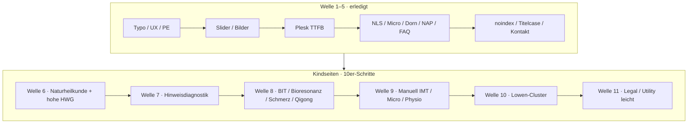

# Umsetzungsplan – rauch-heilpraktiker.de (konsolidiert)

Stand: 2026-08-16 · **Welle 1–10 live** · **nächste Freigabe: Welle 11** (Legal/Utility)  
Massgabe: Repo `redshift-three67/naturheilpraxis-eeat` · Live CDP `127.0.0.1:9224` · ein Schritt nach `docs/WORKFLOW.md`  
YMYL/HWG: keine Heilversprechen · Disclaimer/Autor nur sitewide (HFCM #7) · Schema nur HFCM #6 + Rank Math

**B5** = strukturelle/technische Ableitung von der öffentlichen Site buerofuenf.de (keine Inhalte, kein Design-Klon).

---

## Lage nach Welle 1–5

Sitemap: **64** https-URLs (`page-sitemap.xml`). Davon sind **nicht** mehr der Engpass:

| Schicht | Status | Was schon sitzt |
|---------|--------|-----------------|
| Technik / Trust | live | HFCM #6 Schema, #7 Disclaimer+NAP+3 FAQ, #8–12 UX/Speed/Typo/Kontakt |
| 7 Hubs + Start + Kontakt | live | HUB-01…07, VERF-01…18 **auf den Hubs** |
| Speed | live | TTFB ~0,25 s · Mobil 81 / Desktop 98 · LCP weiter CSS/JS, nicht TTFB |
| Titel/Metas Kern | live | META-01…06 auf Hauptseiten |

**Offen und sichtbar für Google:** die **48 Kindseiten**. Auf den Hubs stehen bereits die gekürzten Verfahrenstexte; die zugehörigen Unter-URLs haben oft noch den alten Wortlaut (Beispiel: Hahnemann auf `/naturheilkunde/` ist VERF-01, `/klassische-homoeopathie/` ist unverändert). Das ist der nächste Block.

Nicht in den 10er-Content-Wellen als Volltext: 8 Legal/Utility (Impressum, Datenschutz, Corona, Download, Rechtshinweise). Die bekommen **Welle 11** (leicht: H1/Meta/NAP/Aktualität).

Extern unverändert: GBP/Verzeichnisse (Betreiber). Optional später: nginx HTML-HIT, Render-blocking CSS nur mit Exclude-Liste.

---

## Kindseiten-Standard (gilt für jede URL gleich)

Massstab ist **nicht** „kürzer um jeden Preis“, sondern dieselbe Qualität wie HUB/VERF.

### Inhalt und Recht (Google YMYL + HWG)

1. **Eine H1**, die das Verfahren oder die Diagnostik benennt – kein Werbesatz, kein gesplittetes H1 (`Was die | Hypnotherapie | leisten kann`).
2. **2–4 kurze Absätze:** Herkunft/Begriff → was in der Praxis stattfindet → Grenze (ohne zweiten Disclaimer-Satz).
3. **Keine Heilversprechen:** `heilt`, `geheilt`, `Heilung garantiert`, `ohne Nebenwirkung`, `sanft heilen`, Outcome-Titel. Diagnostik heisst **Hinweisdiagnostik**, wo das rechtlich zutrifft.
4. **Keine Indikationskataloge** als Behandlungsversprechen (Symptomlisten nur, wenn sie erklären, *worüber gesprochen wird*, nicht *was geheilt wird*).
5. **Trust nicht duplizieren:** Hinweis, Autor, NAP, FAQ bleiben HFCM #7. Kein zweiter Legal-Satz im Fließtext.
6. **Erfahrung ohne Erfindung:** Praxisbezug (Augsburg, Heilpraktiker Rauch) nur, wo er stimmt. Keine neuen Titel, Auszeichnungen, Studien, die nicht belegt sind.

### Struktur (B5, nur was hier hilft)

| ID | Auf jeder Kindseite | Nicht tun |
|----|---------------------|-----------|
| **B5-CLUSTER** | Sichtbarer Link **zurück zum Hub** + 2–4 Geschwister derselben Familie | Neue Glossar-URLs, Keyword-Farm |
| **B5-H1** | Eine klare H1; Größe erbt HFCM #11 | Zweite H1 in Hero/Slider |
| **B5-TYPE** | Fließtext 400 / Zeile ≥ 1,55 (sitewide) | Seite-eigene Schrift-Hacks |
| **B5-FAQ** | Nur wenn die Antwort **sichtbar** im HTML steht | FAQPage pro Kindseite |
| **B5-NAP** | bleibt sitewide | Adresse in jedem Verfahrenstext |
| **B5-IMG** | erbt HFCM #9 (`sizes`, lazy) | 1920-px-Helden neu anlegen |

**Nicht B5:** Product-Schema, Award-Leiste, GTM-First, 100 Lexikon-URLs.

### Titel und Meta (Playbook `04-ymyl-titles-metas`)

- Muster: `Verfahren | Naturheilpraxis Rauch` (Ort nur wenn natürlich, Umlaute gesetzt).
- Meta **120–160 Zeichen**, sachlich, kein Claim. Dünne Autos (`Dorntherapie` = 12 Zeichen) ersetzen.
- Kein neues JSON-LD pro Kindseite (bleibt MedicalClinic+Physician + Rank-Math WebPage).

### Technik / Ablauf

- Prewrite → **eine URL** live (YOO-Feld per Inhalt finden, nicht leeres Feld 8–10) → Cache-Bust-Verify → Archiv → erst dann die nächste URL.
- Nach Speichern: `process.exit(0)`, kein `page.close()`.
- Nach **10 URLs** stoppen: Wellenprotokoll, Freigabe für die nächste 10.
- Rollback: Feldstand aus `archive/2026-08-15/prewrite/` (bzw. Tagesordner).

### Near-Duplicates (vor dem Schreiben entscheiden, nicht zwei Lange pflegen)

| Paar | Empfehlung |
|------|------------|
| `/naet-methode-allergie-behandlung/` (1722 Wörter) vs `/allergiebehandlung-mit-naet/` | Erste URL = Verfahrenstext; zweite = kurzer Ergänzungstext + Link zur ersten. Kein 301 ohne Freigabe. |
| `/elektroakupunktur-nach-dr-voll-3/` vs `/hinweisdiagnostik-eav-elektroakupunktur-nach-dr-voll/` | EAV = Hinweisdiagnostik; Voll-Seite = Verfahren ohne Diagnose-Claim. Texte **unterscheiden**, nicht kopieren. |
| Sieben Lowen-URLs | Jede Seite **ein** Aspekt, kurz; kein siebentes Mal dieselbe Methode. |

---

## Wellen 6–11 (48 Kindseiten + 8 Legal)

Priorität: **YMYL-Risiko** und **sichtbarer Bruch zum schon fertigen Hub**. Cluster bleiben zusammen (B5-CLUSTER), damit interne Links nach der Welle stimmen.

### Welle 6 – Naturheilkunde-Kinder + höchste HWG-Last (10)

**Live:** Cluster HFCM #13. **6A:** drei H1 + NAET-Title + Heilmeditation-Meta (`archive/2026-08-16/WELLE-6A.md`). Fließtexte sonst unangetastet. Archiv `WELLE-6.md`.

Hub `/naturheilkunde/` ist fertig; die Kinder widersprechen ihm im **Wortlaut** noch – der Wortlaut bleibt bis zur Absprache / Adwords-Phase.

| # | URL | Warum zuerst | Live-Befund |
|---|-----|----------------|-------------|
| 1 | `/klassische-homoeopathie/` | Direkter Bruch zu VERF-01 | 1200 Wörter, alter Hahnemann inkl. „heilt“ |
| 2 | `/die-komplex-homoeopathie/` | Geschwister, gleicher Hub | 761 Wörter |
| 3 | `/die-phytotherapie/` | H1 „Pflanzen als Heilmittel“ | 2 H1 |
| 4 | `/naet-methode-allergie-behandlung/` | Längste Kindseite | 1722 Wörter |
| 5 | `/allergiebehandlung-mit-naet/` | Near-Duplicate | kürzer halten, auf #4 verweisen |
| 6 | `/naturheilkundliche-darmsanierung/` | Hub-Kind, 2 H1 | 1001 Wörter |
| 7 | `/orthomolekulare-therapie/` | Lang + YMYL-Nährstoffe | 1515 Wörter |
| 8 | `/injektionstherapie/` | Hub-Kind, Claim-H1 | „gezielte Behandlung“ |
| 9 | `/heilmeditation/` | Höchstes HWG-Risiko im Titel | Meta „Gesundung von Körper…“ |
| 10 | `/hypnotherapie-augsburg/` | 3 H1, Outcome-Titel | „Was die Hypnotherapie leisten kann“ |

Nach Welle 6: Hub Naturheilkunde und seine öffentlichen Kinder sagen **dasselbe** in derselben Tonlage.

### Welle 7 – Hinweisdiagnostik-Cluster (10)

**Live:** Cluster an HUB-02 `/nls-diagnostik/`. Texte unverändert. Archiv `archive/2026-08-16/WELLE-7.md`.

Google und HWG: Diagnostik nicht als Krankheitssicherung darstellen.

| # | URL | Besonderheit |
|---|-----|--------------|
| 1 | `/naturheilkundliche-gesundheitsdiagnostik/` | **0 H1**, 13 Risky-Treffer |
| 2 | `/hinweisdiagnostik-in-der-naturheilkunde/` | Einstieg, Meta nur 39 Zeichen |
| 3 | `/hinweisdiagnostik-eav-elektroakupunktur-nach-dr-voll/` | EAV-Kanone |
| 4 | `/elektroakupunktur-nach-dr-voll-3/` | H1 „Therapie- und Diagnostik“ trennen |
| 5 | `/hinweisdiagnostik-frequenztherapie/` | dünne Meta |
| 6 | `/hinweisdiagnostik-irisdiagnose/` | dünne Meta |
| 7 | `/vital-und-naehrstoffanalyse/` | 11 Risky, Meta 26 Zeichen |
| 8 | `/vieva-pro-herzratenvariabilitaet/` | 2 H1 |
| 9 | `/diagnose-urinuntersuchung/` | Titel „Diagnose“ → Hinweis/Untersuchung prüfen |
| 10 | `/diagnostik-stuhluntersuchung/` | wie #9 |

### Welle 8 – BIT / Bioresonanz / Schmerz / Qigong (10)

**Live:** Cluster HFCM #13. Texte unverändert. Archiv `archive/2026-08-16/WELLE-8.md`.

| # | URL | Besonderheit |
|---|-----|--------------|
| 1 | `/diagnose-labordiagnose-biodiagnostik/` | Rest Diagnostik |
| 2 | `/biophysikalische-informationstherapie-bit/` | 2 H1, Titel schon META-sauber |
| 3 | `/diagnostik-informationstherapie/` | Elternseite BIT |
| 4 | `/bioresonanz-versus-elektroakupunktur/` | 2 H1, Vergleich ohne Sieger-Claim |
| 5 | `/akupunktur-ohne-nadeln/` | Trikombin-Kind zu HUB-03 |
| 6 | `/150-mhz-befeldung-nach-broers-3/` | **18 Risky**, 2 H1 |
| 7 | `/kinesiologie/` | 2 H1; hängt an Schmerz- und NH-Hub |
| 8 | `/schmerztherapie-entstehung-von-schmerz/` | Meta 38 Zeichen |
| 9 | `/zhineng-qigong/` | Psych-/Körperverfahren |
| 10 | `/zhineng-qigong-nach-dr-pang-ming/` | Begründer-Seite, kurz halten |

### Welle 9 – Manuell: IMT, Microkinesie, Dorn, Osteo, Physio (10)

**Live:** Cluster HFCM #13 an HUB-06. Texte unverändert. Archiv `archive/2026-08-16/WELLE-9.md`.

| # | URL | Besonderheit |
|---|-----|--------------|
| 1 | `/microkinesi-therapie/` | Hub-Text ist VERF-17; Kind noch alt |
| 2 | `/microkinesi-behandlungsmoeglichkeiten/` | 1108 Wörter, ASCII im Title |
| 3 | `/dorntherapie/` | Meta **12 Zeichen** |
| 4 | `/osteopathie-techniken/` | 2 H1, „Harmonische Schmerzbehandlung“ |
| 5 | `/physiotherapie-allgemeines/` | |
| 6 | `/physiotherapie-taetigkeitsfelder/` | H1 „Was kann sie?“ |
| 7 | `/integrative-manual-therapy-imt/` | **nur Gegenprüfen** (VERF-14/14b schon live) |
| 8 | `/imt-denk-und-behandlungsansaetze/` | 1665 Wörter |
| 9 | `/imt-behandlungsmoeglichkeiten/` | 5 Risky |
| 10 | `/integrative-manual-therapy-die-begruender/` | Meta 42 Zeichen |

### Welle 10 – Lowen-Cluster (8)

**Live:** Cluster HFCM #13. Texte unverändert. Archiv `archive/2026-08-16/WELLE-10.md`.

Sieben Facetten plus Rehabilitation. Jede URL ein Aspekt, gleicher Ton wie HUB-06.

| # | URL | Besonderheit |
|---|-----|--------------|
| 1 | `/funktionelle-strukturelle-rehabilitation/` | IMT-Rehab |
| 2 | `/lowen-systems-allgemeines/` | Title ≠ H1 |
| 3 | `/lowen-systems-biovalent-system/` | H1 „sanft und zielsicher“ |
| 4 | `/lowen-systems-begruender-frank-lowen/` | Personenseite, keine Heilaussage |
| 5 | `/lowen-systems-und-die-koerper-rhythmen/` | Title ASCII `Koerper`, Meta 38 |
| 6 | `/arbeit-mit-den-regulatoren/` | Meta 26 |
| 7 | `/lowen-systems-und-die-koerpersysteme/` | Meta 35 |
| 8 | `/lowen-systems-und-die-haende/` | Title-Rest `DIE HÄNDE` |

### Welle 11 – Legal / Utility (leicht, 8)

Kein Verfahrenstext. Nur Konsistenz, damit Trust-Seiten Google und HWG nicht unterlaufen.

| URL | Arbeit |
|-----|--------|
| `/impressum/` | NAP gegen HFCM #7 / Schema |
| `/datenschutzerklaerung/` | unangetastet ausser offensichtlicher Widerspruch |
| `/datenschutzerklaerung-tools/` | Meta 26 Zeichen |
| `/heilpraktiker-rechtshinweise/` | Meta 28; Claims prüfen |
| `/rechtshinweise-therapieverfahren/` | behalten, Ton an #7 angleichen falls nötig |
| `/gesundheitsrelevante-dokumentation/` | **H1 lautet „Impressum“** – korrigieren |
| `/corona-praxis-offen/` | Freigabe: aktualisieren oder `noindex` (veraltete YMYL-Lage) |
| `/downloadbereich-naturheilpraxis-rauch/` | Anamnese-Links auf Lovable-App prüfen |

---

## Was schon erledigt ist (nicht zurückdrehen)

TQW-01…04 · SCHEMA-01…04 · META-01…06 · NOINDEX-01 · APP-01…07 · SPEED-01/02/03 · SLIDER-01 · UX-01/02/04/05 · QW-SITEMAP · HWG-01 · CONTENT-01/01b · KONTRAST-01 · HUB-01…07 · VERF-01…18 · B5-TYPE-01 · RESP-01 · B5-IMG · B5-NAP-01 · B5-FAQ-01 · QW-NOINDEX · QW-TITELCASE · HFCM #12 Kontakt.

### Welle 1–5 (Referenz)

| Welle | Inhalt | Status |
|-------|--------|--------|
| 1 | B5-TYPE-01, UX-04, UX-05 | live |
| 2 | RESP-01, B5-IMG-01/02 | live |
| 3 | Plesk TTFB, SPEED-03 Mobil 81 / Desktop 98 | live |
| 4 | NLS-Restfett, Micro/Dorn, NAP, FAQ | live |
| 5 | noindex aus, Titelcase aus, Kontakt-Satz; GBP extern | live (GBP offen) |

Pagespeed-Referenz (Startseite, 15.08.2026 22:11): Mobil 81 / LCP 4,82 s / TTFB 255 ms · Desktop 98 / TTFB 244 ms. Kindseiten erben dasselbe CSS/JS; kein neues Speed-Plugin in Welle 6–10.

---

## Freigabe

**Nächste Freigabe:** Welle 11 (Legal / Utility, 8 URLs, leicht: H1/Meta/NAP/Aktualität, kein Verfahrenstext).

Optional parallel (nicht im 10er-Takt, Betreiber): GBP-NAP = `Friedrich-Deffner-Straße 19a, 86163 Augsburg`, Tel `0821 2621462`.
