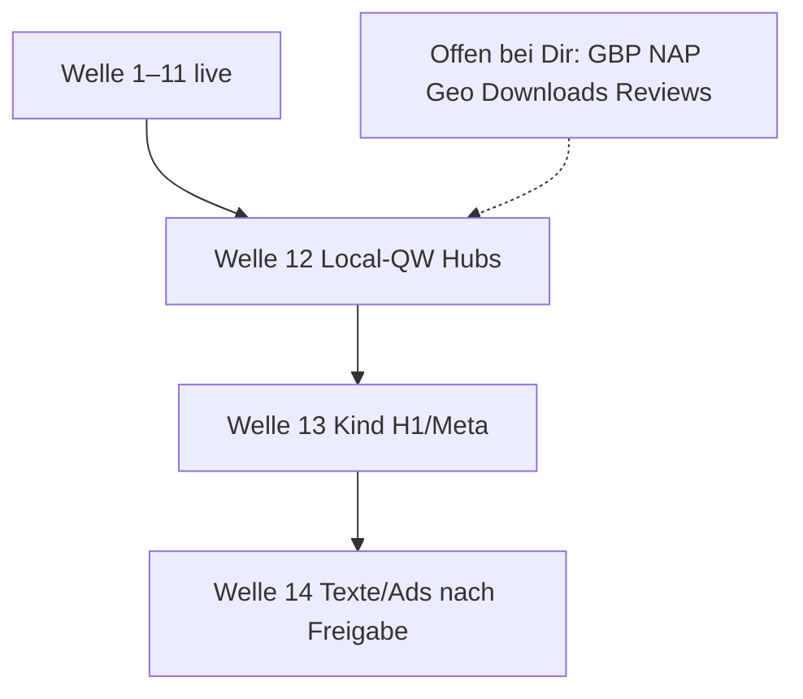

# Umsetzungsplan – rauch-heilpraktiker.de (konsolidiert)

Stand: 2026-08-16 · Welle 1–11 live  
Massgabe: Repo `redshift-three67/naturheilpraxis-eeat` · CDP `127.0.0.1:9224` · `docs/WORKFLOW.md`  
YMYL/HWG: keine Heilversprechen · Disclaimer/Autor nur HFCM #7 · Schema nur HFCM #6 + Rank Math

**B5** = Struktur/Technik von buerofuenf.de, kein Inhalts- oder Design-Klon.

---

## Kurzantwort auf a–c

| Frage | Lage |
|-------|------|
| **a) 48 Kindseiten = Hub-Niveau?** | **Technik, Trust, Typo, Kontrast, Slider-Höhe/Bilder, Cluster: ja (sitewide).** Verfahrenstext, viele H1/Metas, Absatzlänge: **nein** – bewusst stehen gelassen bis Adwords/Einzel-Freigabe. |
| **b) Hubs lokal googletauglich?** | Kern sitzt (Title/H1 „Heilpraktiker Augsburg“, NAP, MedicalClinic+Geo). **Lücken:** GBP/Verzeichnisse (Betreiber), Schema-Geo = Stadtmitte statt Hochzoll, keine `openingHours`, Rest-H1 auf Schmerz-Hub, NLS noch „Hospital“ im Markup. |
| **c) Top-10 „Heilpraktiker Augsburg“** | Sichtbare Konkurrenz gewinnt über **Stadtteil + Maps/Bewertungen + eine klare H1**, nicht über mehr Unterseiten. Nächster Hebel bei uns: lokales Profil + Geo/Öffnungszeiten + Hub-Feinschliff, nicht neue Glossar-URLs. |

---

## a) Kindseiten vs. Hubs – was schon gleich ist

Alles über HFCM #6–#14 gilt **sitewide**, also auch auf den 48 Kindseiten. Live-Stichprobe 14 Kinder + 8 Hubs (16.08.): Disclaimer, MedicalClinic/Physician, Slider-Markup, `follow, index` überall gleich.

| Schicht | Hubs | 48 Kindseiten | Gleich? |
|---------|------|---------------|---------|
| Schema MedicalClinic + Physician + Geo | HFCM #6 | erbt | **ja** |
| Disclaimer, Autor, NAP, 3 FAQ | HFCM #7 | erbt | **ja** |
| Anamnese-Button, Footer, Cookie | #8 / #10 | erbt | **ja** |
| Slider-Höhe, `sizes`, lazy/eager | #9 | erbt | **ja** |
| Schrift H1 36/500, Fließ 400, Zeile ≥ 1,55, Kontrast | #11 | erbt | **ja** |
| Responsiveness / Farben | #9+#11 | erbt | **ja** |
| Cluster Hub + Geschwister | – | HFCM #13 | **ja (Kinder)** |
| Rank Math Title-Muster Kern | META-01…06 | nur Teil (6A) | **teilweise** |
| Kurze VERF-Absätze, weniger Fett, keine Claims | VERF-01…18 **auf Hubs** | alter Wortlaut | **nein** |
| Eine werbefreie H1 | meist | 6A: 3 Stück; Rest oft Claim/Split/fehlend | **nein** |

**Nicht nachziehbar ohne Text-Freigabe:** Absätze kürzen, „heilt“/Indikationslisten, Hahnemann-Kind vs. Hub, Heilmeditation-Seitenname, zweite H1s (BIT, 150-MHz, Osteo, Lowen „sanft und zielsicher“).

**Stabil nachziehbar (nächste Live-Welle, wenn frei):** dünne Metas, restliche Claim-H1s, fehlende H1 `/naturheilkundliche-gesundheitsdiagnostik/`, Title-ASCII (`Koerper`, `Behandlungsmoeglichkeiten`, `DIE HÄNDE`), Hub-Schmerz zweite H1.

---

## b) Hubs – lokale SEO / SEM / E-E-A-T

### Was schon googletauglich ist

- Start-Title und H1: **Heilpraktiker Augsburg – Naturheilpraxis Peter Rauch**
- Sichtbare NAP + Tel, Autor, FAQ (entspricht sichtbarem HTML → FAQPage)
- `MedicalClinic` + `Physician` + PLZ 86163 + `addressLocality` Augsburg
- ProvenExpert-Widget, Jameda-Profil (19 Bewertungen, 5 Sterne – extern)
- Hubs mit Kindlinks (B5-Cluster), keine Keyword-Farm
- TTFB ~0,25 s · Desktop ~98 · Mobil ~81 (LCP weiter CSS/JS)

### Gefundene Lücken (lokal)

| ID | Fund | Wirkung | Wer |
|----|------|---------|-----|
| **LOC-GEO** | Schema-Geo `48.3665, 10.8944` = **Augsburg-Zentrum** (latlong.net-Stadtmitte), nicht Friedrich-Deffner-Straße / Hochzoll | Local Pack / Entfernung falsch | Live (nach Pin-Bestätigung) |
| **LOC-HOURS** | Keine `openingHours` / `openingHoursSpecification` im JSON-LD (im Footer stehen Mo–Fr 10–19, Mittag 12:30–13) | Maps/Knowledge | Live |
| **LOC-AREA** | Kein `areaServed` (Augsburg, Hochzoll, Friedberg …) | Umkreis | Live |
| **LOC-GBP** | Google-Unternehmensprofil nicht hier prüfbar | stärkster Local-Hebel | **Betreiber** |
| **LOC-NAP-EXT** | Alte Adresse **Seefelder Str. 20** noch in Verzeichnissen (z. B. jobs-in-augsburg) | NAP-Konflikt | **Betreiber** |
| **HUB-H1-SZ** | `/schmerztherapie-augsburg/` zwei H1 | Hierarchie | Live |
| **NLS-HOSP** | `/nls-diagnostik/` Markup enthält noch „Hospital“ | YMYL/Trust | Live |
| **RM-ARTICLE** | Rank-Math-Article-Description Home noch „sanfte, ganzheitliche Medizin“ / „NLS Diagnose“ | Schema-Claim | Live |
| **SEM** | Keine Ads-Phase; Landings = Hubs + saubere Kinder erst nach Text-Freigabe | später | Freigabe |

SEM jetzt: keine Kampagne starten, solange Kindtexte und Corona-Historie/Downloads nicht sitzen. Für Ads später nur Hubs + 1 URL pro Verfahren, nicht 7 Lowen-URLs.

---

## c) Bild der sichtbaren Top-Setzer „Heilpraktiker Augsburg“

Kein Zugriff auf die Live-SERP-Position 1–10 von Google. Das **sichtbare Wettbewerbsset**, das für diese Anfrage durchgängig auftaucht:

| Praxis / URL | Was sie für lokal tun |
|--------------|------------------------|
| Haimerl `heilpraktiker-haimerl-augsburg.de` | Keyword in Domain + H1 „Heilpraktiker Augsburg“ |
| Köpf `heilpraktiker-koepf-augsburg.de` | Domain + Stadtteil **Göggingen** in H1 |
| Boehm `erikboehm.de` | Enge Nische Osteopathie, Name als Marke |
| Weis `therapiepraxis-weis.de` | H1 mit Augsburg + Gersthofen, `MedicalBusiness` |
| Hessingpark | Standortmarke im Title |
| Wagner, augsburg-heilpraktikerin.de, Lachmair, Prüfer, Wenninger | Domain/Ort oder Stadtteil |
| Portale | Jameda, Gelbe Seiten, Doctolib, werkenntdenbesten (Rauch dort gelistet) |

**Was die Setzer nicht besser können als wir:** fachliches Schema, Disclaimer, Hub-Tiefe, TTFB.

**Was sie oft besser haben:** eine einzige lokale H1, Stadtteil, **Google-Bewertungen/Maps-Pin**, schlanke Startseite, manchmal Breadcrumbs.

Domain nicht auf Keyword umbauen. Stadt und Hochzoll gehören in **Start + Hubs + GBP**, nicht in jede Lowen-Unterseite.

### Maßnahmen, die den Seitenwert für diesen Query wirklich heben

1. **GBP + NAP überall gleich** (höchste Local-Priorität).  
2. **Schema-Geo auf die Praxis**, plus Öffnungszeiten und `areaServed`.  
3. **Google-Bewertungen** (Jameda reicht Google Maps nicht).  
4. Hub-Feinschliff (eine H1 Schmerz, NLS ohne Hospital, Article-Text ohne Claim).  
5. Kind-H1/Metas nachziehen (ohne Fließtext), damit der Cluster nicht durch dünne Snippets unterlaufen wird.  
6. Mobil-LCP (render-blocking) nur mit Exclude-Liste, nicht als Default-Plugin.  
7. Keine 100 neuen URLs, keine Award-Leiste, kein Product-Schema.

---

## Offen bei Dir (Betreiber)

Bitte abarbeiten und kurz Rückmeldung; wir fassen das dann gegen Live.

### Pflicht lokal

1. **Google-Unternehmensprofil**  
   Name, **Friedrich-Deffner-Straße 19a, 86163 Augsburg (Hochzoll)**, Tel **0821 2621462**, Website `https://rauch-heilpraktiker.de`, Kategorie Heilpraktiker/Naturheilpraxis.  
   Keine Heilversprechen im GBP-Text. Öffnungszeiten = Footer (Mo–Fr 10–19, Mittag 12:30–13:00) oder korrigieren und uns die gültigen Zeiten geben.  
   Maps-Pin prüfen: sitzt er auf der 19a, nicht in der Innenstadt?

2. **NAP in Verzeichnissen angleichen oder löschen lassen**  
   Gleiche Straße/Tel wie Impressum. Bekannte Altlast: **Seefelder Str. 20**.  
   Nur gezielt: Gelbe Seiten, Das Örtliche, Jameda (Adresse), ProvenExpert. Kein Massen-Listing.

3. **Schema-Geo bestätigen**  
   Bitte den Google-Maps-Pin der Praxis öffnen und uns **Breite/Länge** schicken (oder bestätigen: Hochzoll, nicht Königsplatz). Danach setzen wir HFCM #6.

### Downloads / Altseiten

4. Fünf tote `/download/…`-URLs (Erstinformation, Corona-Auskunft, Vereinbarung, Datenschutz-PDF, Neuaufnahme): **Dateien neu hochladen** oder Buttons im Downloadbereich entfernen. 404-Solution schickt sie derzeit auf die Startseite.  
   Anamnese-DOC existiert: `/wp-content/uploads/peter/Anamnese_Peter_Rauch_Heilpraktiker.doc`. Button zeigt bereits auf Lovable.

5. **Corona-Seite** ist `noindex` + historischer Hinweis. Wenn die URL aus Menü/Download weg soll: sagen, wir nehmen den Menüpunkt raus.

### Bewertungen / Sichtbarkeit

6. Patienten um **Google-Rezension** bitten (nicht nur ProvenExpert/Jameda).  
7. Optional: gleiche NAP in Facebook-Impressum.

---

## Nächste Live-Schritte (wir, nach Freigabe)

Kein Parallel-Write. Reihenfolge = Wirkung für „Heilpraktiker Augsburg“.

### Welle 12 – Local-Quick-Wins Hubs (hoch)

| ID | Schritt | Voraussetzung |
|----|---------|----------------|
| **LOC-GEO** | HFCM #6: echte Praxis-Koordinaten | Pin von Dir |
| **LOC-HOURS** | `openingHoursSpecification` wie Footer | Zeiten bestätigen oder korrigieren |
| **LOC-AREA** | `areaServed`: Augsburg, Hochzoll, ggf. Friedberg | Freigabe der Ortsteile |
| **HUB-H1-SZ** | eine H1 auf `/schmerztherapie-augsburg/` | – |
| **NLS-HOSP** | letztes „Hospital“ auf NLS | – |
| **RM-ARTICLE** | Rank-Math-Article-Description ohne „sanfte Medizin“ / „NLS Diagnose“ | – |

### Welle 13 – Kind-H1/Meta (mittel, kein Fließtext)

Dieselbe Akkuranz wie 6A, nur Felder die **kein** Verfahrenstext sind:

- Fehlende H1 Gesundheitsdiagnostik  
- H1 ohne Outcome: BIT, 150-MHz, Osteo, Lowen Biovalent, Physio „Was kann sie?“, Urin/Labor „Diagnose“ → Untersuchung/Hinweis  
- Dünne Metas: Dorn (12), Urin (27), viele Lowen (26–38), Hinweisdiagnostik-Autos  
- Title-ASCII / `DIE HÄNDE` / `Behandlungsmoeglichkeiten`  
- Optional: sichtbare Breadcrumbs = Cluster-Text (kein Extra-FAQ)

### Welle 14 – Texte / Ads (nur nach Einzel-Freigabe)

Hahnemann-Kind und übrige Fließtexte wie VERF auf den Hubs. Erst dann Google Ads auf Hubs + wenige Landings.

### Nicht tun

Product-Schema, Glossar-Farm, Domainwechsel, Lovable als Ranking-Site, Speed-Plugin ohne Exclude, zweiten Disclaimer, FAQPage pro Kind.

---

## Erledigt (nicht zurückdrehen)

TQW · SCHEMA-01…04 · META-01…06 · HUB-01…07 · VERF-01…18 · Wellen 1–5 (Typo, UX, Bilder, TTFB, NAP/FAQ) · Welle 6–10 Cluster · 6A drei H1 + NAET/Heilmeditation-Meta · Welle 11 Legal (Doku-H1, Metas, Corona noindex, HFCM #14).

**Als Nächstes von Dir:** Punkte 1–3 (GBP, Verzeichnisse, Maps-Koordinaten/Zeiten).  
**Als Nächstes von uns nach „Welle 12 go“:** Geo/Hours/Area sobald der Pin da ist; HUB-H1-SZ, NLS-HOSP, RM-ARTICLE sofort möglich.
